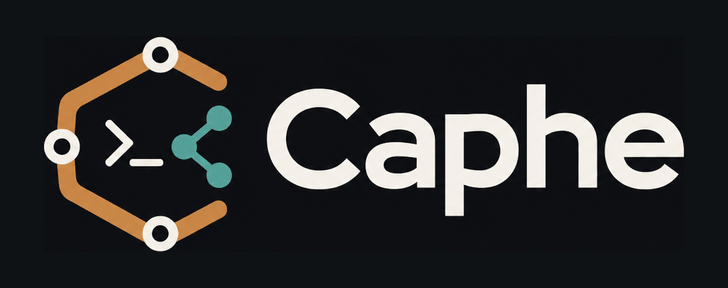

<p align="center">
  
</p>

# Caphe

[](https://github.com/andrew-ships-stuff/caphe/actions/workflows/ci.yml)
[](https://github.com/andrew-ships-stuff/caphe/actions/workflows/e2e.yml)
[](https://github.com/andrew-ships-stuff/caphe/actions/workflows/caphe-pr.yml)
[](https://github.com/andrew-ships-stuff/caphe/blob/main/go.mod)
[](https://github.com/andrew-ships-stuff/caphe/blob/main/LICENSE)

Caphe is a local-first, CPU-native security workflow compiler and executor. It compiles declarative YAML into a content-addressed lock artifact, executes a fixed DAG without model-directed control flow, runs installed security scanners through typed adapters, preserves their raw output, and stores normalized evidence in SQLite.

The deterministic engine does not require an LLM, GPU, Kubernetes, Docker, API key, or database server. Optional inference is designed around a loopback-only external `llama.cpp` server and schema-bounded security hypotheses; model output is never promoted directly to a confirmed vulnerability.

## Current working scope

- Go CLI: `version`, `doctor`, `init`, hardware inspection, tool discovery, workflow validation/compilation/lock validation, scan/run, findings, graph queries, reports, and AI status/recommendation.
- Real installed-tool adapters for Opengrep, Syft, Grype, Gitleaks, Poutine, OPA, OSV-Scanner, Checkov, and Kubescape. No production mock fallback exists.
- Canonical workflow locks with adapter pinning, bounded timeout/retry policy, security/syntax gate records, and SHA-256 digests.
- Dependency-aware concurrent executor with partial failure, cancellation, raw artifact retention, and execution manifests.
- SQLite findings/evidence store and content-addressed artifact files.
- Native JSON, SARIF 2.1.0, and self-contained HTML reporting.
- CPU/memory/disk inspection and conservative, explicitly unvalidated model recommendations.
- A Go inference interface and loopback-only `llama.cpp` HTTP provider. Managed runtime/model downloads are not implemented yet.

See [docs/roadmap.md](docs/roadmap.md) for the exact boundary between implemented and planned functionality.

## Build

Requirements: Go 1.26 or newer for this development snapshot.

```bash
go build -o caphe ./cmd/caphe
go test ./...
go vet ./...
./caphe version
./caphe doctor
```

Scanners are optional per workflow. Install the tools required by the selected workflow and verify them with:

```bash
caphe tools doctor
```

Caphe never silently substitutes generated findings when a scanner is missing. On macOS, Linux, and Windows, install scanner releases from their respective upstream projects: Opengrep, Anchore Syft, Anchore Grype, Gitleaks, Poutine, OPA, OSV-Scanner, Checkov, and Kubescape. Pin versions in CI and preserve the execution manifest that records detected versions.

For an easily removable local toolchain, Caphe can install checksum-verified Poutine and actionlint releases into its own cache:

```bash
make tools-install
export PATH="${XDG_CACHE_HOME:-$HOME/.cache}/caphe/bin:$PATH"
caphe tools doctor
```

Set `CAPHE_CACHE` or pass `scripts/install-tools.sh --bin-dir PATH` to choose another location. Removing that dedicated directory removes the managed binaries. Caphe does not install system packages or request elevated privileges.

Homebrew users can install commonly used tools independently:

```bash
brew install poutine syft grype gitleaks opa osv-scanner checkov kubescape actionlint
```

`scripts/install-tools.sh` only manages tools with reviewed version and checksum pins. Install OPA, OSV-Scanner, Checkov, and Kubescape independently until equivalent pins are added; Caphe will discover them from `PATH`. actionlint remains a repository/CI companion rather than a workflow adapter.

## Homebrew installation

Until a versioned tap is published, build the current checkout with the included HEAD formula:

```bash
brew install --HEAD --formula ./packaging/homebrew/caphe.rb
caphe version
```

The intended release command will be `brew install andrew-ships-stuff/tap/caphe` after the tap and signed release artifacts exist. This repository does not claim that unpublished command works today.

Release installation scripts are provided in `scripts/` and require an explicit version. They verify release checksums and install to a user directory. No stable release endpoint is claimed yet, and neither script provisions scanners or inference without a separate user action.

## Five-minute local demo

The included fixture is deliberately vulnerable and must not be deployed.

```bash
go build -o caphe ./cmd/caphe
./caphe workflows validate caphe:demo-local
./caphe compile caphe:demo-local --output demo.lock.json
./caphe validate demo.lock.json
./caphe run demo.lock.json --target examples/vulnerable-go
./caphe findings list
./caphe report --format json --output caphe-report.json
./caphe report --format sarif --output caphe-report.sarif
./caphe report --format html --output caphe-report.html
```

`caphe:demo-local` (bundled in the binary) uses real Opengrep and Syft executables. Its Opengrep rule is stored with the target, so the demo does not fetch a ruleset. The broader default workflow additionally uses Grype and treats unavailable Gitleaks/Opengrep tasks as optional.

State defaults to the user config directory under `caphe/`. Use `--data-dir PATH` for isolated runs.

Initialize state and add only missing repository security configuration with:

```bash
caphe init --project .
```

This creates `.poutine.yml` and `.github/dependabot.yml` when absent. Existing files are reported and never overwritten. Use `--no-project-config` when only local Caphe state should be initialized.

## End-to-end tests

The primary integration path builds the real CLI, compiles and validates a workflow, runs a controllable scanner process, persists findings to SQLite, and validates SARIF output:

```bash
make test-e2e
```

The real-tool path scans this repository with Poutine through Caphe's compiled executor:

```bash
make tools-install
export PATH="${XDG_CACHE_HOME:-$HOME/.cache}/caphe/bin:$PATH"
make test-e2e-real
```

## Workflow example

```yaml
apiVersion: caphe.dev/v1alpha1
kind: SecurityWorkflow
metadata: {name: local-demo, version: "1.0.0"}
spec:
  target: {type: repository}
  policies:
    network: restricted
    executeGeneratedCode: false
    allowActiveTesting: false
  tasks:
    - id: sast
      uses: scanner.opengrep
      with: {ruleset: .caphe/security.yaml}
    - id: normalize
      uses: core.normalize
      needs: [sast]
```

Caphe passes scanner arguments as an argument array, never through a shell. Repository content remains untrusted; ordinary subprocess execution is not a strong sandbox. Read [docs/security.md](docs/security.md) before scanning hostile repositories.

The additional adapters can be selected in any custom workflow:

```yaml
tasks:
  - id: dependency-vulnerabilities
    uses: scanner.osv
    optional: true
    with: {offline: true}
  - id: infrastructure
    uses: scanner.checkov
    optional: true
    with: {framework: "terraform,kubernetes"}
  - id: kubernetes
    uses: scanner.kubescape
    optional: true
    with: {useArtifactsFrom: .kubescape}
  - id: policy
    uses: scanner.opa
    optional: true
    with:
      policy: policy/deny.rego
      input: policy/input.json
      query: data.caphe.deny
```

OPA queries should return a boolean, string, or collection of objects. Object results may include `id`, `message`, `severity`, `path`, and `line`. OSV-Scanner normally uses its remote vulnerability database; set `offline: true` after pre-downloading its local database. Checkov runs with result upload and policy downloads disabled, and Caphe redacts source blocks and evaluated values by default. Set `includeSensitiveOutput: true` only when full Checkov evidence is explicitly required and the artifact store is protected. Set Kubescape's `useArtifactsFrom` to a pre-downloaded artifact directory when it must remain offline.

## Terminal and automation output

Caphe commands are human-readable by default. Diagnostics, scanner coverage, workflow execution, findings, validation, and AI status use aligned sections with `✓`, `✗`, `!`, and `○` status marks. Long-running audits and workflow runs show a spinner only when stdout is an interactive terminal; redirected output never receives terminal control sequences.

Pass the global `--json` flag anywhere in the command to retain stable machine-readable output:

```bash
caphe doctor                 # terminal dashboard
caphe doctor --json          # JSON for scripts and CI
caphe findings list          # readable finding list
caphe findings list --json   # structured findings
```

`caphe report` defaults to a readable table. Use `--format json`, `--format sarif`, or `--format html` for report artifacts; `caphe report --json` also selects JSON when no explicit format is supplied.

## License

MIT. See [LICENSE](LICENSE).
